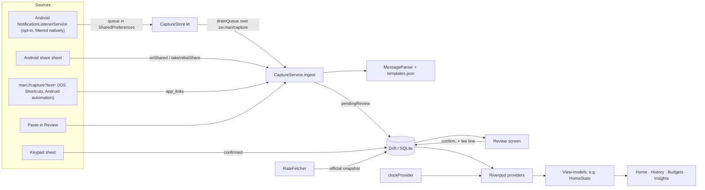

# Architecture

## Layers

Dependencies point one way: `core` ← `domain` ← `data` / `capture` ← `app` ← `widgets` ← `features`. `test/architecture_test.dart` reads every import in `lib/` and fails the build when a file breaks a rule below, naming the file and the import.

| Layer | Holds | May not |
|---|---|---|
| **`lib/core`** | Design tokens and theme, `Money` (integer minor units), date ranges, the `Clock` type, the three-language string table | Import anything else in the app, Riverpod or Drift |
| **`lib/domain`** | Immutable models, `budget_math.dart` (totals, budget lines, month summary, pace), `month_tree.dart`, `tree_tones.dart`. Pure functions, unit-tested with no Flutter and no database | Import any package, or anything but `core` |
| **`lib/data`** | The Drift database, repositories behind small interfaces, the rate fetcher, CSV export. The only place that knows Drift or the network | Import Flutter widgets, Riverpod, or anything above it |
| **`lib/capture`** | `CaptureService.ingest(text, source:)`: parse, de-duplicate, store a pending entry. The parser is a port of `tool/parser_reference.js`; both run the same fixtures | Import screens or widgets |
| **`lib/app`** | The composition root: providers, `AppLifecycle`, `MariApp`, settings | — |
| **`lib/widgets`** | Shared building blocks (cards, buttons, sheets, bars, money text) | Import screens or `data` |
| **`lib/features/*`** | Screens. A screen with real logic has a view-model next to it (`home_state.dart`) | Import Drift or `lib/data/db` |

### Providers

`lib/app/providers.dart` is one import for screens; behind it each file owns one concern and only depends on the ones before it:

`time` → `data` → `settings` → `rates` → `ledger` → `tree`

- **`time_providers.dart`** — `clockProvider` is the only source of "now". `todayProvider` rolls over at midnight by itself and is refreshed when the app resumes; `currentMonthProvider` follows it. Nothing else in `lib/` may call `DateTime.now()` (enforced by the architecture test), so any test can pin the date.
- **`ledger_providers.dart`** — month-scoped streams (`monthEntriesProvider(month)`, `budgetLinesProvider(month)`, `monthSummaryProvider(month)`), derived from database streams, so a write anywhere updates every screen.
- **`tree_providers.dart`** — day totals, tones and the Seasons shelf. The shelf watches only the twelve months it can show (`seasonEntriesProvider`), so its cost does not grow with years of history.

### View-models

Numbers a screen shows are worked out away from the widgets. `lib/features/home/home_state.dart` has `buildHomeState(...)`, a pure function from the month's summary, tones and day totals to a `HomeState` (hero figure, days left, per-day figure, pace, today). `HomeScreen` only lays it out, and `test/home_state_test.dart` covers the edge cases (no budget, over budget, last day of the month) without pumping a widget.

### Lifecycle

`lib/app/lifecycle.dart` (`AppLifecycle`) owns the work that happens around the screens: starting capture, draining captured alerts every 5 s while the app is open, refreshing the rate at most every six hours, and telling `todayProvider` when the app resumes. `Shell` is navigation only.

### Startup

`main()` opens the database, reads settings and loads the parser before the first frame, with no network on the path. If any of that throws, `StartupFailure` says so and offers a retry; the app never sits on a blank screen.

## Key decisions

- **Money is never a double.** Amounts are stored in cents. Each entry also stores its US$ and ZiG equivalents **frozen at the rate used that day**, plus the rate itself. Past months never change when today's rate moves; budgets (which are forward-looking) convert at today's rate.
- **Two currencies, not two accounts.** Every amount carries its currency; the display currency is a lens, not a ledger.
- **Cash-out is a transfer.** Moving money from EcoCash to your pocket is not spending, so the `cash_out` category is excluded from spend and income totals.
- **Pending until confirmed.** Captured entries live in the same table with `status = pendingReview` and are excluded from every total.
- **De-duplication** uses the message's transaction reference when it has digits (the same EcoCash payment often arrives as both an SMS and an app notification), otherwise a stable FNV-1a fingerprint of the text, within a three-day window.
- **Offline-first startup.** `main()` opens the database, reads settings and loads the parser before the first frame. The rate fetch runs after, at most every six hours.
- **Time is injected.** Every "now" comes from `clockProvider`, so month boundaries, greetings and "days left" are testable and the screens can be rendered at a fixed moment.
- **Settings live in SQLite**, in the same file as transactions, so "delete all my data" is genuinely all of it.

## Database (schema v2)

| Table | Purpose |
|---|---|
| `categories` | Seeded on first open; names in en/sn/nd; kind = income / expense / transfer |
| `entries` | Every transaction, confirmed or pending, with raw source text for captured ones |
| `budgets` | One monthly limit per category, in either currency, optional rollover |
| `rates` | Official ZiG/USD snapshots (the person's own rate lives in settings) |
| `settings` | Key/value preferences |

Indexes (added in v2): `entries (status, occurred_at)` for every month query, and `entries (source_ref)` for de-duplication. `test/database_test.dart` opens a hand-built v1 database and checks it is upgraded in place with its records intact, and asks SQLite's query planner to confirm the month query uses the index.

Settings are saved as a diff: `SettingsController.edit` writes only the keys that changed, in one batch.

Changing a table: edit `lib/data/db/database.dart`, bump `schemaVersion`, add an additive `if (from < n)` step to `onUpgrade`, add a case to `test/database_test.dart`, then run `dart run build_runner build --delete-conflicting-outputs`.

## Tests that guard the structure

| Test | Fails when |
|---|---|
| `architecture_test.dart` | A file imports across a layer boundary, or reads the wall clock directly |
| `contrast_test.dart` | A colour token drops a text/ground pair below WCAG AA |
| `database_test.dart` | A migration loses data or an index goes missing |
| `screens_test.dart` | Any main screen overflows or throws on a 390 pt phone, a 360 pt phone at the largest text size, in any of the three languages, light or dark. It also saves each screen to `build/screens/` (CI uploads them as `mari-screens`) |
| `home_state_test.dart`, `time_test.dart` | Home's numbers or the day rollover are wrong |
