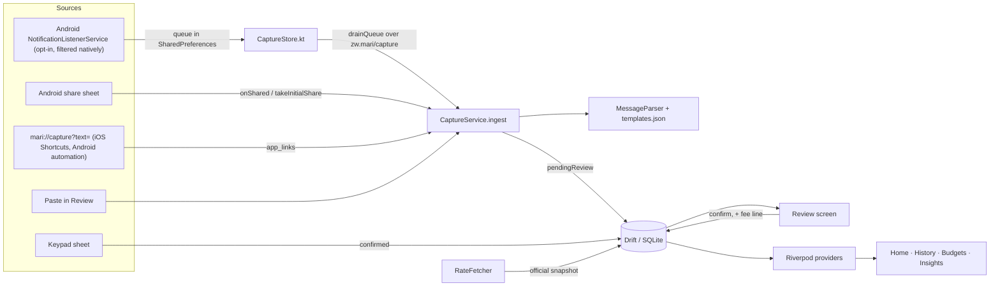

# Architecture

## Layers

**`lib/core`** has no knowledge of the app's data: design tokens and theme, `Money` (integer minor units, conversion, formatting), date ranges, and the three-language string table.

**`lib/domain`** holds plain immutable models (`Entry`, `Category`, `Budget`, `RateSnapshot`) and `budget_math.dart`, a set of pure functions that every screen's numbers come from. They are unit-tested without Flutter or a database.

**`lib/data`** is the only place that knows about Drift. Repositories map Drift rows to domain models behind small interfaces (`EntryRepository`, `BudgetRepository`, …). A sync backend can be added later by implementing those interfaces; screens never see a Drift type.

**`lib/capture`** is the single entry point for every message: `CaptureService.ingest(text, source:)` parses, de-duplicates and stores a pending entry. The parser is a port of `tool/parser_reference.js`; both run the same fixtures.

**`lib/app/providers.dart`** wires it together with Riverpod. Month-scoped providers (`monthEntriesProvider(month)`, `budgetLinesProvider(month)`, `monthSummaryProvider(month)`) are derived from database streams, so any write anywhere updates every screen.

## Key decisions

- **Money is never a double.** Amounts are stored in cents. Each entry also stores its US$ and ZiG equivalents **frozen at the rate used that day**, plus the rate itself. Past months never change when today's rate moves; budgets (which are forward-looking) convert at today's rate.
- **Two currencies, not two accounts.** Every amount carries its currency; the display currency is a lens, not a ledger.
- **Cash-out is a transfer.** Moving money from EcoCash to your pocket is not spending, so the `cash_out` category is excluded from spend and income totals.
- **Pending until confirmed.** Captured entries live in the same table with `status = pendingReview` and are excluded from every total.
- **De-duplication** uses the message's transaction reference when it has digits (the same EcoCash payment often arrives as both an SMS and an app notification), otherwise a stable FNV-1a fingerprint of the text, within a three-day window.
- **Offline-first startup.** `main()` opens the database, reads settings and loads the parser before the first frame. The rate fetch runs after, at most every six hours.
- **Settings live in SQLite**, in the same file as transactions, so "delete all my data" is genuinely all of it.

## Database (schema v1)

| Table | Purpose |
|---|---|
| `categories` | Seeded on first open; names in en/sn/nd; kind = income / expense / transfer |
| `entries` | Every transaction, confirmed or pending, with raw source text for captured ones |
| `budgets` | One monthly limit per category, in either currency, optional rollover |
| `rates` | Official ZiG/USD snapshots (the person's own rate lives in settings) |
| `settings` | Key/value preferences |

Changing a table: edit `lib/data/db/database.dart`, bump `schemaVersion`, add a step to `migration`, then run `dart run build_runner build --delete-conflicting-outputs`.
